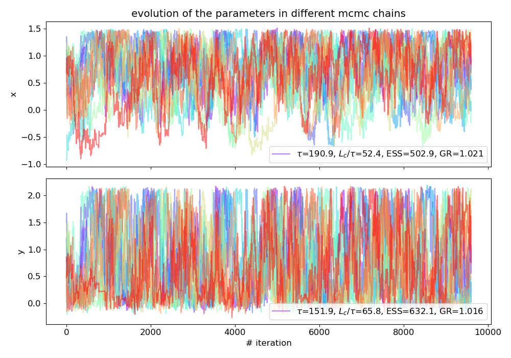
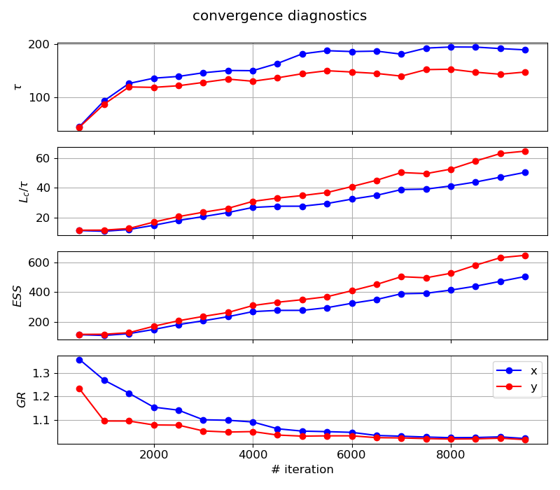
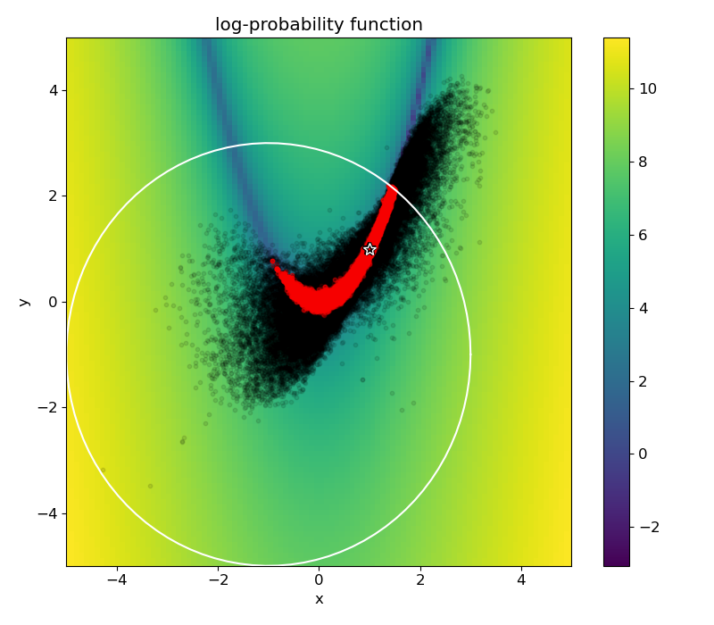
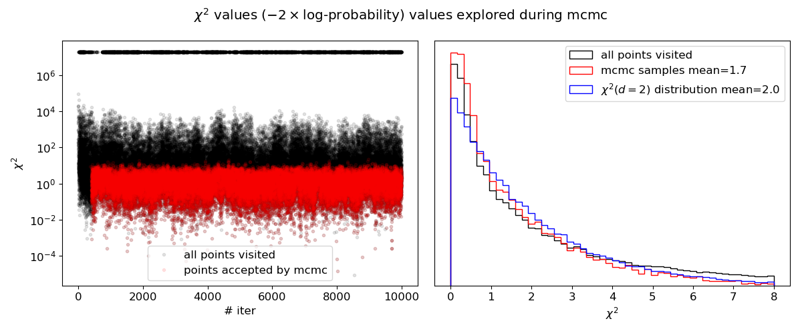
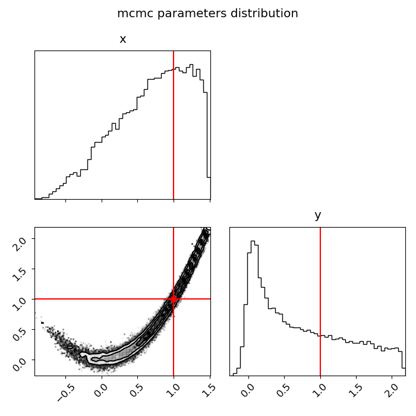
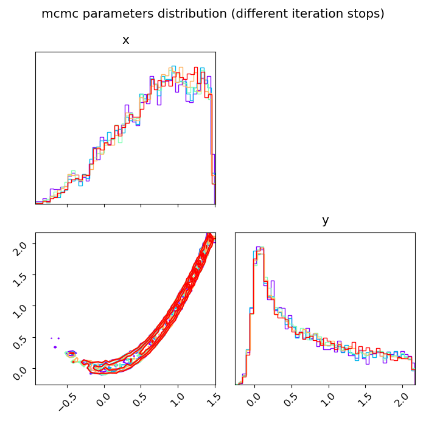

## MCMC

The heart of Bayesian model calibration (BMC) or Bayesian parameter estimation is to find the probability distribution 
of the model parameters. 
In more than a few dimensions a grid over parameter space is hopeless, since its size grows exponentially with the 
dimension. Markov chain Monte Carlo (MCMC) instead produces a sequence of points distributed according to the posterior 
$p$: histograms of the points estimate the posterior, and averages over them estimate posterior expectations.

The standard Metropolis algorithm does this with a random walk. From the current point $\theta$ it proposes a step 
$\theta'=\theta+\delta$, with $\delta$ drawn from a symmetric distribution (typically a Gaussian of width $\sigma$), 
and accepts it with probability $\min(1, p(\theta')/p(\theta))$; if the step is rejected, $\theta$ is recorded again. 
This rule leaves $p$ unchanged (detailed balance), so the chain converges to it, and since only the ratio 
$p(\theta')/p(\theta)$ enters, the posterior's unknown normalization cancels. 
Its weak point is the proposal: $\sigma$ must be tuned by hand, a correlated or elongated posterior forces it down to 
the narrowest direction, and a single chain is inherently sequential. 
Later algorithms keep the accept/reject construction and improve the proposal. The ensemble sampler used here builds 
its proposals from the positions of many parallel chains, so it adapts to the scale and orientation of the posterior 
and its chains can be evaluated in parallel.

---

This example's plots are generated using [example_mcmc.py](../example_mcmc.py).

We choose the log-probability function as minus the 2d-Rosenbrock function, with zero probability assigned outside of 
the constraint circle (as defined in the [optimization example](optimization.md)).
The parallel ensemble MCMC algorithm is via [``emcee``](https://github.com/dfm/emcee).

We pick the initial points to initiate the MCMC chains (or workers) at random, but for an expensive black-box query 
in higher dimension an optimization should be done first, and the initial points chosen around the minima.

We pick $N_c=10$ chains times $L_c=10^4$ iterations per chain. 
Progress of the chains with iterations (after some burn-in):

The MCMC results require testing convergence diagnostics, as discussed in the [emcee docs](https://emcee.readthedocs.io/en/stable/tutorials/autocorr/):

* The integrated auto-correlation time $\tau$ needs to be calculated (per parameter). 
It is advised that the length of each chain $L_c$ to be over $50\tau$ to trust the estimation.
(note that $\tau$ itself usually increases with $L_c$ until it saturates and converges so $L_c/\tau$ 
does not simply rise proportionally to $L_c$)
`emcee` estimates $\tau = 1 + 2\sum_{t\ge1}\rho(t)$, with $\rho(t)$ the autocorrelation at lag $t$: it computes $\rho$ 
per chain with an FFT, averages it over the parallel chains, and sums it only up to the smallest window $M \ge 5\hat\tau(M)$, 
since the noisy far tail of $\rho$ would otherwise dominate the sum. Averaging over chains increases the estimation 
accuracy, but additional chains do not necessarily help $\tau$ converge faster (with smaller $L_c$). 
The derivation and the bias and variance of this estimate are in chapter 4 of the theory and manual report, 
[04_mcmc.tex](theory_and_manual/chapters/04_mcmc.tex).

* The effective sample size (ESS) defined as the total number of samples divided by the 
auto-correlation time $ESS=N_{total}/\tau=N_c \times L_c/\tau$ is advised to be 10-100 times the number of parameters.
In this case the ESS will scale proportionally to the number of parallel chains $N_c$.

* The [Gelman-Rubin statistic](https://pymcmc.readthedocs.io/en/latest/modelchecking.html) is another convergence metric that approaches 1 when converged. However, it is not 
relevant for the ensemble MCMC algorithm because the chains are inherently correlated, but it can be a supplementary 
diagnostic. 

All the mentioned metrics are shown per parameter in the legend of the figure above, and their dependence on the chain 
length $L_c$:

2d visualization of the log-probability function (log absolute of the values), 
the points visited by the algorithm (black) and the points accepted to the MCMC samples set (red):

Another visualization is to look at $\chi^2=-2\cdot \log p$ values evolution during the MCMC, 
and the histogram of the values accepted to the MCMC samples set (red).

The histogram can be compared with the one generated from a $\chi^2$ distribution in 2 dimensions (blue).
The means of both distributions are numerically calculated and written in the legend (the analytic value for the mean of the $\chi^2$ distribution should be the dimension). 

The final product of the Bayesian analysis is a [``corner``](https://github.com/dfm/corner.py) plot of the parameters distribution:

A convergence test of the parameters distributions, assuming the MCMC is stopped at 5 different points along the chains (progression in colors going from purple to red):

