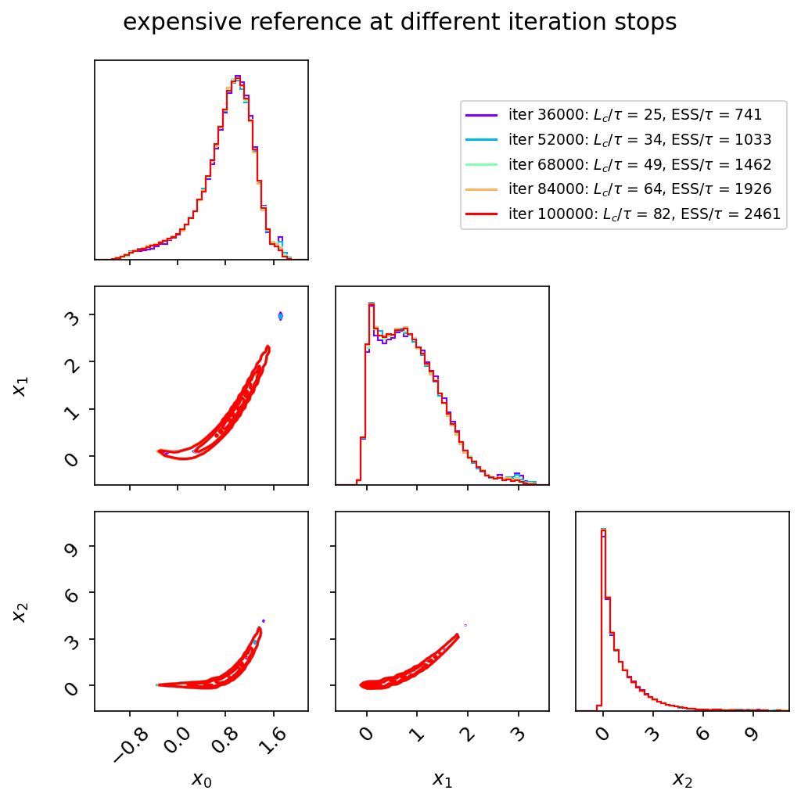
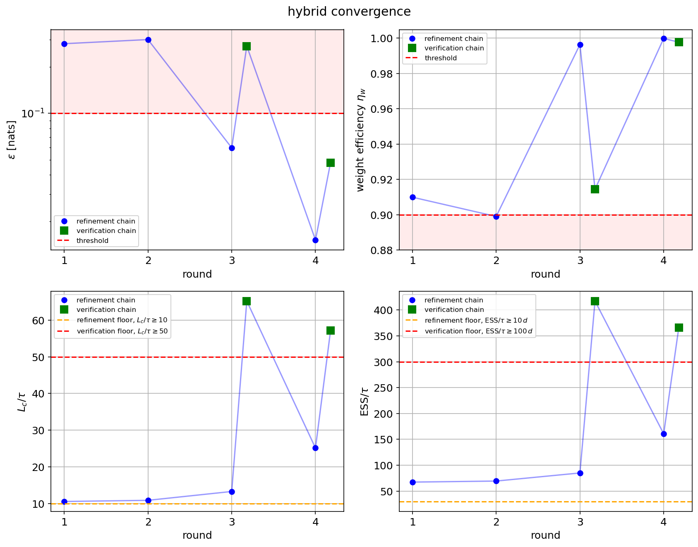
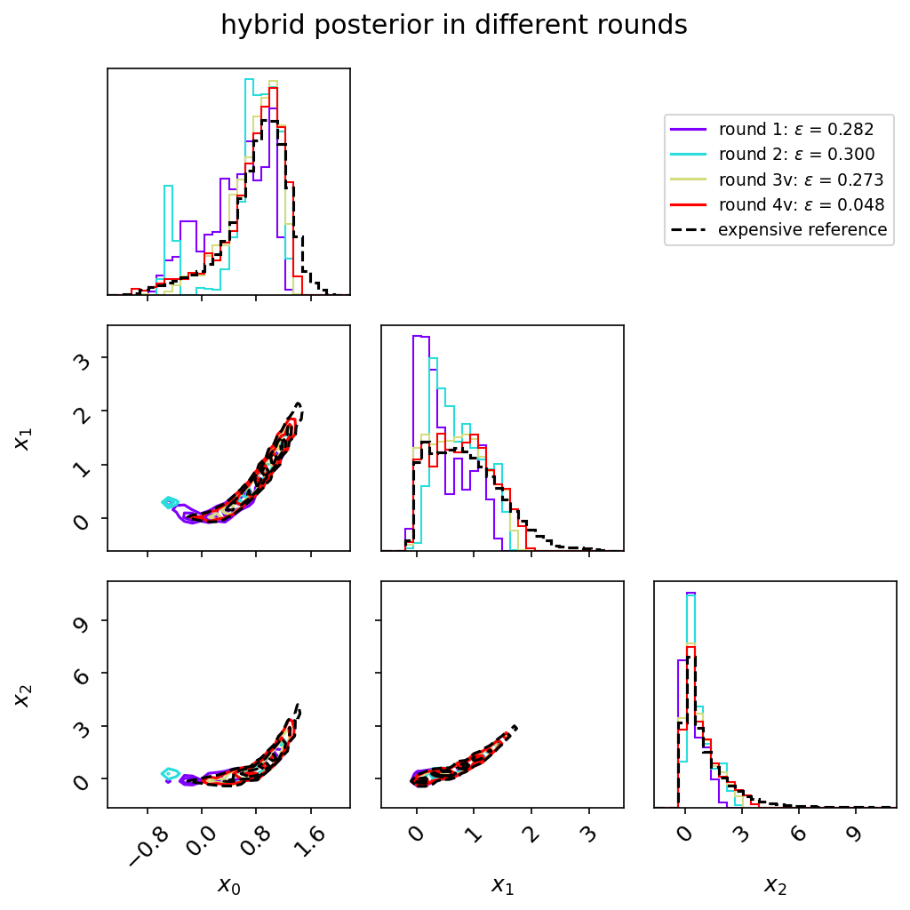
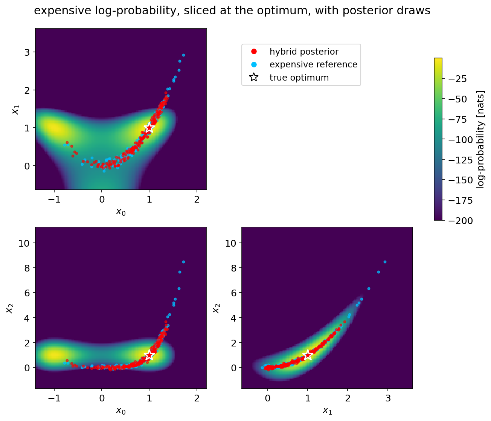
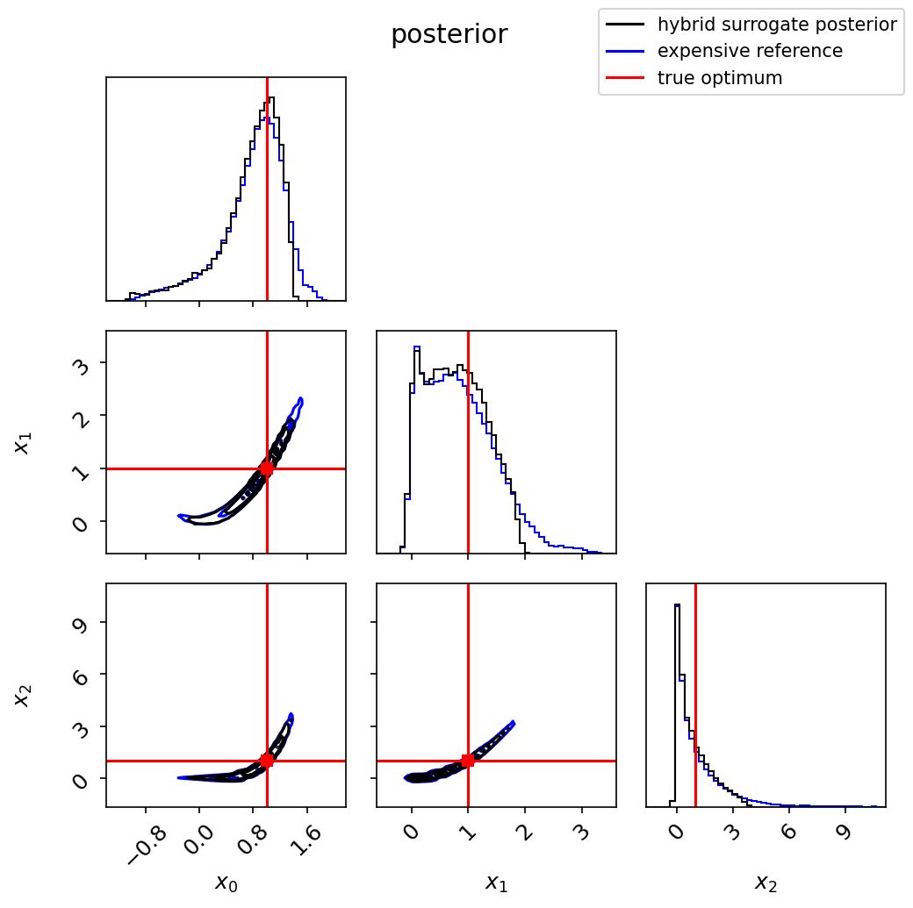

## MCMC with surrogate (automated hybrid pipeline)

[mcmc_surrogate.md](mcmc_surrogate.md) describes the manual procedure: evaluate the expensive
model, fit a surrogate, sample the surrogate. It does not tell you how many expensive evaluations
were enough, or whether the surrogate posterior is the real one. `slurm_mcmc_hybrid` automates it,
iterating until measured criteria say to stop.

[example_mcmc_hybrid.py](../example_mcmc_hybrid.py) is a runnable template: a 3D Rosenbrock, every
argument on its own line, and the figures below. Copy it and replace `log_prob_fun`. The theory,
the defaults and the worked example in full are in chapter 6 of the theory and manual report,
[06_hybrid.tex](theory_and_manual/chapters/06_hybrid.tex) (build
[theory_and_manual.tex](theory_and_manual/theory_and_manual.tex) with LaTeX).

Requires the `hybrid` extra: `pip install -e ".[hybrid]"` (scikit-learn).

### The loop

1. **Round 0.** A short expensive MCMC, plus optional `num_regularization_points`, makes the first
   training set. Its walkers are evaluated in parallel on the cluster. Existing evaluations can
   replace it: pass `initial_train_points` and `initial_train_values`, e.g. from a previous
   `slurm_mcmc`:

   ```python
   pool = status['slurm_pool']
   result = slurm_mcmc_hybrid(..., initial_train_points=pool.points_history,
                              initial_train_values=pool.values_history[:, 0])
   ```
2. **Fit** a surrogate: a Gaussian process by default.
3. **Sample** it with a cheap MCMC (no cluster). This chain is kept short, because its posterior
   is thrown away at the next fit.
4. **Validate.** Evaluate the expensive function on `num_validation_points` drawn from the
   surrogate posterior, and score the criteria below.
5. **Refine.** If they fail, the validation points join the training set and the loop repeats.
6. **Verify.** A pass is only provisional: the same surrogate is re-sampled to reporting depth and
   scored on one more validation batch. If it still passes, that posterior is returned; otherwise
   refinement resumes. No evaluation is wasted: every batch joins the training set.

### What is measured

On the validation points, with $d_i = \log p_\mathrm{exp}(\theta_i) - \log p_\mathrm{sur}(\theta_i)$
and importance weights $w_i = e^{d_i}$:

- **Surrogate accuracy** $\varepsilon$: the weighted spread of $d_i$, in nats. $\varepsilon = 0.05$
  means probability ratios are accurate to about 5%. Must be at most `log_error_threshold`.
- **Weight efficiency** $\eta_w = (\sum w_i)^2 / (N \sum w_i^2)$: roughly the fraction of the
  surrogate posterior that lies where the target has mass. It catches spurious lobes and over-wide
  tails that $\varepsilon$ cannot see. Must be at least `min_weight_efficiency`.
- **Posterior shift** $\delta$: the largest change of a parameter's mean or width since the previous
  round, in posterior standard deviations. Tested only when `posterior_shift_tolerance` is set (off
  by default), and never below the sampling noise floor of two finite chains.

**What the test cannot see.** Everything is measured on points drawn from the *surrogate*
posterior, so it detects a posterior that is too broad, but not one that is too narrow: mass the
surrogate never finds is never scored. The worked example misses a tail in exactly this way. For
multimodal or heavy-tailed targets, spend some budget on `num_regularization_points`, disperse
`init_points`, and check the result with a short independent expensive chain.

### Worked example: 3D Rosenbrock

A narrow, curved, banana-shaped posterior. Because it is analytic, a plain expensive MCMC
(3,000,000 evaluations) gives a reference to judge the hybrid against. Its convergence along the
chain:



The hybrid run uses a `DistributedGPSurrogate`, 30 expensive walkers, a deliberately small round 0
(`num_expensive_iters=10`, `num_regularization_points=50`), and defaults otherwise. It converged in
4 rounds on 1,580 expensive evaluations, about 0.05% of the reference's.



Top: the criteria per round, the shaded region being what a converged run must stay out of.
Bottom: how deeply the surrogate chain was sampled. Blue circles are the short refinement chains,
green squares the verification chains. Round 3 passed on its short chain but failed verification;
round 4 passed both.



Each round's posterior (`save_posterior_samples`), against the reference dashed. The first round is
visibly off; from the second on the shape is right.



The expensive target in each parameter pair (a slice at the optimum), with draws from the hybrid
posterior (red) and the reference (blue). The dots are projections of the 3D posterior, so a
bright patch without dots is not by itself a missed mode.



The hybrid posterior against the reference. The centres agree, but the hybrid is too narrow in
$x_1$ and $x_2$: it never sampled the far end of the banana, so it never scored it. **Treat widths
and tails from a hybrid run as unconfirmed** unless an independent expensive chain checks them.

**The diagnostics file.** Every run writes `<work_dir>/hybrid_diagnostics.txt`, rewritten each
round: the settings (each `'auto'` with what it resolved to), the evaluation budget, and one row per
round with the criteria (`w_log_err`, `w_eff`, `post_shift`, `shift_tol`), the chain depth
(`surr_iters`, `Lc/tau`, `ess/tau`), the training set before and after trimming (`n_expensive`,
`n_train`), and timings. A verified round has two rows, `n` and `nv`.

### Arguments

Required:

| argument | notes |
|---|---|
| `log_prob_fun` | The expensive log-probability, or a dict `{module_dir, module_name, function_name}` to avoid pickling problems. |
| `init_points` | Round-0 walkers, shape `(num_walkers, num_params)`, more than `2 × num_params`. Disperse them. Not needed with `initial_train_points`. |
| `param_bounds` | Optional, `[[lo, hi], ...]`. Bounds constrain the **posterior**: use them for real physical limits only. `None` (default) runs unbounded, see below. |

Budget:

| argument | default | notes |
|---|---|---|
| `num_expensive_iters` | required | Round-0 chain length, `(num_expensive_iters + 1) × num_walkers` evaluations. Aim for about `100–500 × num_params` in all. |
| `initial_train_points`, `initial_train_values` | `None` | Existing evaluations to start from instead of round 0. |
| `num_regularization_points` | `0` | Points spread over the prior box (or around the data when unbounded). 10–20% of the training set helps find mass the chains miss. |
| `num_validation_points` | `'auto'` | Expensive evaluations per round, recycled as training data: `max(200, 10 × num_params)`. |
| `num_rounds_max` | `100` | Safety cap. |
| `num_expensive_iters_per_round` | `0` | Optional expensive MCMC steps each round, seeded from the surrogate posterior. |

Surrogate:

| argument | default | notes |
|---|---|---|
| `surrogate` | `'gp'` | `'gp'`, `'polynomial'`, `DistributedGPSurrogate(...)`, or any object with `fit` / `predict` (and `predict_std` for the uncertainty penalty). |
| `polynomial_degree` | `2` | For `surrogate='polynomial'`. |
| `surrogate_uncertainty_penalty` | `1.0` | The cheap chain samples $\mu - \kappa\sigma$, which keeps it away from where the surrogate extrapolates. `0` disables. |

Sampling the surrogate:

| argument | default | notes |
|---|---|---|
| `num_surrogate_iters` | `'auto'` | Chain length, sized from the measured autocorrelation time $\tau$ and extended until the floors below hold. |
| `max_surrogate_iters` | `1_000_000` | Ceiling on a chain's length. A chain whose $L_c/\tau$ stops rising is also stopped, with a warning. |
| `num_surrogate_walkers` | `'auto'` | $2d+2$, emcee's minimum: for a fixed cost, fewer walkers give longer chains. |
| `surrogate_burnin_fraction` | `0.2` | Fraction of each chain discarded. |
| `refine_surrogate_ess`, `verify_surrogate_ess` | `'auto'` | Effective-sample floors: $10\,d$ while refining, $100\,d$ while verifying. |
| `refine_iters_per_tau`, `verify_iters_per_tau` | `'auto'` | Chain-length floors $L_c/\tau$: 10 while refining, 50 while verifying. |
| `max_verification_attempts` | `None` | Rejected verifications allowed before the run gives up; `None` is unlimited, `0` turns verification off. |

Convergence:

| argument | default | notes |
|---|---|---|
| `log_error_threshold` | `0.1` | $\varepsilon_{\max}$ in nats. Tighten to 0.01–0.02 for tails or Bayes factors. |
| `min_weight_efficiency` | `0.9` | Floor on $\eta_w$: at most ~10% of the surrogate posterior where the target is negligible. |
| `posterior_shift_tolerance` | `None` | $\delta_{\max}$ in posterior standard deviations; `None` does not test it. 0.1 when the surrogate may still be improving between rounds. |

Training data:

| argument | default | notes |
|---|---|---|
| `train_log_prob_trim_range` | `100.0` | Drop points more than this many nats below the best: the MCMC never visits them. Raise to ~`2d` beyond 50 dimensions. `None` disables. |
| `min_train_points_after_trim` | `'auto'` | Skip the trim when it would leave fewer points: `10 × num_params`. |
| `max_train_points` | `None` | Cap on the fitted points, by uniform random subsampling. |
| `train_log_prob_floor` | `None` | Absolute floor, for dropping penalty or failure values. |

Saving:

| argument | default | notes |
|---|---|---|
| `save_restart` / `load_restart` | `False` | Write / resume from `restart_file` (`'hybrid_restart.pkl'`), after every round and when a verification starts. Also the way to extend a finished run: raise `num_rounds_max` and resume. |
| `status_restart` | `None` | Resume from a status dict in memory. |
| `save_posterior_samples` | `None` | Draws kept per round in `<work_dir>/posteriors/posterior_round{k}.npy`. |
| `save_surrogate` | `None` | `'latest'` or `'all'`: fits saved in `<work_dir>/surrogates/surrogate_round{k}.pkl`, so a resumed round can skip its refit. |

Cluster and plumbing: `work_dir`, `job_name`, `cluster` (`'slurm'` / `'local'` / `'local-map'`),
`submitit_kwargs`, `job_fail_value`, `constraint_fun`, `extra_arg`, `expensive_mcmc_kwargs`,
`verbosity`, `slurm_verbosity`, `log_file`, `install_signal_handler` and the `remote*` options
behave as in every other `slurm_*` function. `keep_run_dirs` (`'all'` / `'failed'` / `'none'`)
controls the per-batch directories of `'slurm'` and `'local'` runs. `random_seed` makes a run
reproducible, including across a restart.

### DistributedGPSurrogate

A dense GP's fit grows roughly with the cube of the training set, so on a long run it comes to
dominate. `DistributedGPSurrogate` (a robust Bayesian Committee Machine) splits the training set
among GP experts fitted in parallel and recombines their predictions, each weighted by how much it
learned at that point. Fitting becomes cheap, but every MCMC step queries all the experts, so
sampling becomes the larger cost: measure it against the dense GP on your target first.

| argument | default | notes |
|---|---|---|
| `max_points_per_expert` | `None` | **Set this** (500 is a good default): the number of experts then grows with the data. |
| `num_experts` | `8` | Used only without `max_points_per_expert`. |
| `min_points_per_expert` | `200` | Fewer points per expert falls back to fewer experts, down to the dense GP. |
| `partition` | `'kmeans'` | `'kmeans'` or `'random'`. |
| `n_restarts_optimizer` | `2` | Optimizer restarts per expert. |
| `parallel` | `'none'` | `'joblib'` (one process per core; the usual choice) or `'slurm'` (a job array, worth it only for long expert fits). |
| `n_jobs` | `-1` | For `'joblib'`. |
| `cluster`, `work_dir`, `job_name`, `submitit_kwargs`, `max_fit_retries` | | For `'slurm'`. `work_dir` must be on a shared filesystem; failed experts are retried individually. |
| `trend_degree` | `2` | Polynomial mean function; `None` disables. |

### Restarting, and changing surrogate

With `save_restart=True` a long run can be resumed with `load_restart=True`. The restart file
holds only surrogate-agnostic state, so a run can resume with a different surrogate, for instance
moving to an ensemble when dense fits get too slow:

```python
slurm_mcmc_hybrid(..., surrogate='gp', save_restart=True, work_dir='run17')

# later, on the same training data
slurm_mcmc_hybrid(..., load_restart=True, save_restart=True, work_dir='run17', num_rounds_max=40,
                  surrogate=DistributedGPSurrogate(max_points_per_expert=500, parallel='joblib'))
```

### Results and warnings

The result carries per-round lists of everything that decided the run, including
`blocking_criteria_per_round` (what held each round back), the cheap chain's depth, the emulator's
own uncertainty (`surrogate_std_per_round`), and `verified_per_round`. Warnings fire when posterior
mass piles up against `param_bounds`, and when a cheap chain stops short of its floors.

### Running without bounds

With `param_bounds=None` no box is imposed. Away from its data a surrogate can run off to infinity,
so the run confines the cheap chain to an envelope grown from the training set: nothing acts inside
twice the data's largest Mahalanobis radius, and it grows as evaluations spread out. With a GP the
uncertainty penalty turns the walkers back long before the envelope, which matters mostly for
surrogates without `predict_std`. If posterior mass reaches the envelope, the reported tails are
partly its doing.
